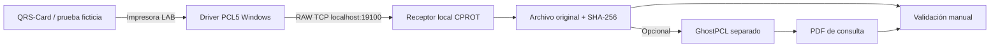

# CPROT QRS-Card — impresión y captura de estudios


Aplicación de escritorio para Windows con interfaz CPROT, vigilancia de archivos PDF, envío a la cola de impresión y archivado manual de estudios por paciente. **Incorpora un prototipo de captura nativa PCL/RAW sin PDFCreator.**

> [!CAUTION]
> **Captura PCL experimental, NO validada para uso clínico.** No es un sistema médico certificado ni garantiza la continuidad o exactitud diagnóstica de un ECG. La impresora real y las configuraciones de QRS deben permanecer intactas mientras realizamos pruebas con datos ficticios.

## Dos modalidades en una aplicación

| Capacidad | PDF / Watchdog existente | Captura RAW / PCL experimental |
|---|---|---|
| Origen | PDFCreator u otro generador de PDF | Cola de impresión de laboratorio apuntando a 127.0.0.1 |
| PDFCreator necesario | Solo si se usa para generar los PDF | **No** |
| Original conservado | PDF | Flujo RAW tal como llega: PCL, PS, PDF o archivo parcial |
| Salida PDF | PDF generado por el programa de origen | Conversión manual con GhostPCL separado, cuando es PCL |
| Recepción mientras se imprime | Detecta PDF ya generado | **Recibe bytes durante la transmisión TCP** |
| Trazo ECG continuo en pantalla | No | **No**: solo conserva lo que el software manda a imprimir |
| Verificación de papel impreso | No | No: la cola de laboratorio no imprime físicamente |
| Uso en consultorio | Tras validar contra impresora real | **No**, hasta superar validación formal |

La captura protege el archivo original con una huella SHA-256. **El cierre de la conexión TCP no prueba que una prueba de esfuerzo haya finalizado:** el controlador puede dividir o mantener abiertos los trabajos. Un PDF convertido puede alterar fuentes, proporciones o la representación del trazado, por lo que se compara con el papel original antes de utilizarlo.

## Interfaz y módulos

La interfaz CPROT incluye encabezado azul, modo oscuro/claro, indicadores de vigilancia, selección de impresora, listado de PDF, selección de documentos por paciente e historial de eventos.

El botón **Captura PCL5 · LAB** abre una ventana independiente con estado del receptor TCP, avance en bytes, archivos conservados, trabajos incompletos y conversión opcional. La captura escucha **únicamente en 127.0.0.1**, puerto predeterminado **19100**, con límite de 512 MiB por conexión. **No intercepta silenciosamente la impresora del consultorio ni la convierte en virtual.**

## Requisitos

- Windows 10/11 y Python 3.11 o posterior (si se ejecuta desde fuente).
- Bibliotecas del archivo `requirements.txt`: PyMuPDF, Pillow, pywin32, watchdog y ttkbootstrap.
- Para la prueba PCL: driver Windows **PCL5 compatible y ya instalado**. Su nombre debe verificarse; no basta con que diga «PCL».
- Opcional: **GhostPCL** separado, para convertir PCL a PDF. No se incluye ni se distribuye con CPROT QRS-Card; revisar términos de licencia Artifex.

## Instalación en Windows con Python

Abre PowerShell:

```powershell
git clone https://github.com/josesamuelramirez1998-oss/Wachdog-impresora-.git
cd Wachdog-impresora-
git switch feature/native-pcl-capture-prototype
py -3 -m venv .venv
.\.venv\Scripts\python.exe -m pip install -r requirements.txt
.\.venv\Scripts\python.exe print_manager.py
```

### Programa portable

En el Pull Request de la rama, visita **Checks / Actions → Windows portable application**, descarga el artefacto de Windows x64, **descomprime la carpeta completa** y ejecuta `CPROT-QRS-Card.exe`. Es una compilación experimental sin firma digital; revisa su origen y utiliza solo equipos de prueba.

## Captura PCL sin PDFCreator: guía segura

**No uses estudios reales ni cambies la impresora predeterminada.** QRS-Card debe probarse primero con datos de simulación.

1. Abre CPROT QRS-Card → **Captura PCL5 · LAB**. Elige una carpeta privada y pulsa **Iniciar receptor**.
2. Verifica que muestre `127.0.0.1:19100`.
3. Desde PowerShell consulta los drivers: `Get-PrinterDriver | Select-Object Name`. Identifica un driver que **realmente genere PCL5**.
4. Ejecuta el script de configuración **sin aplicar cambios**:

   ```powershell
   .\scripts\setup_capture_printer.ps1
   ```

5. Cuando confirmes un controlador adecuado, aplica explícitamente la creación de una cola de laboratorio:

   ```powershell
   .\scripts\setup_capture_printer.ps1 -DriverName "NOMBRE EXACTO DEL CONTROLADOR PCL5" -Apply
   ```

6. Windows creará **CPROT QRS Capture (LAB)**, una impresora nueva con puerto RAW TCP local `127.0.0.1:19100`. No modifica la impresora predeterminada ni instala drivers.
7. Elige esa impresora **solo** en una aplicación de prueba o en QRS con un estudio ficticio y envía un documento. El receptor muestra los bytes recibidos.
8. Al terminar la conexión, revisa el trabajo. Guarda el archivo original. Si fue identificado como PCL y su estado es completo, selecciona el ejecutable GhostPCL y pulsa **Convertir PDF**.
9. Compara el PDF con el reporte original: derivaciones, cuadrícula, continuidad, escala, velocidad, calibración y márgenes.

Windows utiliza el **Standard TCP/IP Port Monitor** para enviar trabajos RAW. Puede consultar SNMP o requerir ajustes del controlador para no marcar la impresora virtual como desconectada. Si no llegan bytes, no significa necesariamente que QRS no haya imprimido: revisa primero que el driver y la cola de prueba sean compatibles.

### Desinstalar únicamente la impresora de laboratorio

```powershell
.\scripts\remove_capture_printer.ps1
.\scripts\remove_capture_printer.ps1 -Apply
```

El primer comando **solo muestra el plan**. El segundo elimina la cola de prueba y su puerto si pertenecen a la captura local; nunca elimina controladores ni cambia la impresora predeterminada.

## Arquitectura experimental



**La salida de una impresora no equivale necesariamente al registro ECG completo.** Esta aplicación no interpreta la señal del equipo, no modifica los archivos nativos QRS y no recrea datos que nunca fueron enviados al puerto de impresión.

## Watchdog de PDF y expedientes

La modalidad anterior sigue disponible. Configura en PDFCreator (u otra aplicación) el guardado automático a una carpeta temporal, elige esa carpeta como **Origen**, selecciona una impresora Windows real y una carpeta diferente como **Destino**.

- Vigila PDF creados, modificados o movidos. Comprueba estabilidad y estructura antes del envío.
- Serializa impresiones, limita la resolución a un máximo de 300 DPI y persiste el registro de trabajos. Evita reenvíos automáticos frecuentes tras reinicios.
- Selecciona y confirma **únicamente los estudios del mismo paciente** antes de moverlos al expediente.
- «Enviado al spooler» **no confirma** que el papel se haya impreso.
- El PDF creado por la modalidad experimental **no se envía automáticamente** a la cola clínica ni se asocia automáticamente a un paciente.

## Datos, seguridad y recuperación

- La nueva captura guarda por defecto sus originales y manifiestos en `%LOCALAPPDATA%\QRS-Card\capturas_pcl`.
- En `%LOCALAPPDATA%\QRS-Card\pcl_capture_settings.json` se guardan puerto, ruta y ubicación opcional de GhostPCL.
- Los manifiestos indican estado, tamaño, SHA-256 y formato estimado. **Los originales pueden contener datos sensibles de salud**: utiliza permisos Windows, cifrado de disco, copias de seguridad protegidas y control de acceso.
- Capturas interrumpidas, por timeout o sobre el límite se guardan como `.partial` y **no se convierten automáticamente**.
- El receptor escucha exclusivamente en la interfaz local y no envía contenido a una nube. Otro proceso del mismo equipo podría enviar datos al puerto; la aplicación no autentica procesos locales.
- La modalidad PDF conserva su bitácora en `%LOCALAPPDATA%\QRS-Card\print_jobs.json`. No la borres para intentar corregir duplicados sin revisar el estado real de la impresora.
- Los PDF de GhostPCL son **archivos de consulta experimentales**, no sustituyen reportes originales, estudios SCP ni copias certificadas.

## Pruebas automatizadas

```bash
python -m unittest discover -s tests -v
python -m py_compile print_manager.py print_core.py cprot_ui.py pcl_capture.py pcl_capture_ui.py
```

Las pruebas del prototipo incluyen sockets locales con cargas sintéticas, verificación exacta de bytes y SHA-256, separación de conexiones, trabajos parciales, defensa frente a rutas no válidas y conversión simulada sin GhostPCL real. La CI de GitHub también comprueba el arranque de la interfaz y crea una versión portátil de Windows.

**Ninguna prueba automatizada demuestra fidelidad clínica con QRS-Card ni funcionamiento con el modelo real de impresora.**

## Validación pendiente y documentación

Antes de reemplazar PDFCreator o usar esta solución en un procedimiento médico se requiere verificar versión de QRS, **Real Time Print**, PCL5 emitido por el driver, comportamiento de impresión continua, segmentación de trabajos y exactitud visual frente a una impresión de referencia.

Consulta el [diseño técnico de captura nativa](docs/DISENO_CAPTURA_NATIVA_QRS.md) para requisitos, decisiones y criterios de aceptación.

**Fuentes:** [Microsoft — Add-PrinterPort](https://learn.microsoft.com/en-us/powershell/module/printmanagement/add-printerport) · [Microsoft — Standard TCP/IP Print Monitor](https://learn.microsoft.com/en-us/troubleshoot/windows-server/printing/standard-port-monitor-for-tcpip) · [Artifex — GhostPDL](https://github.com/ArtifexSoftware/ghostpdl).
