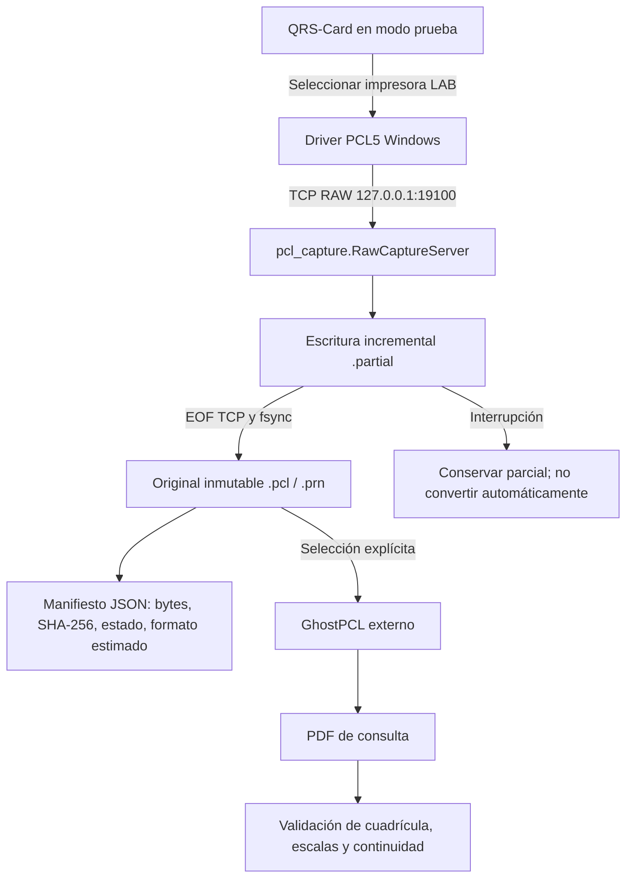

# Diseño técnico CPROT QRS-Card — captura RAW / PCL5 sin PDFCreator

**Estado:** prototipo de laboratorio implementado en la rama `feature/native-pcl-capture-prototype`, pendiente de validación con versión concreta de QRS-Card, impresora y equipo ECG de prueba.

> [!WARNING]
> **No usar como sustituto de una impresión o un registro clínico oficial.** Una transmisión TCP completada no demuestra que se conservó la señal del estudio completo. La fidelidad ECG requiere comparar velocidad, amplitud, escala, derivaciones, marcadores y continuidad contra documentos de referencia.

## 1. Problema y objetivos

QRS-Card y otras aplicaciones médicas heredadas pueden imprimir trazos durante una prueba de esfuerzo sin producir automáticamente un archivo PDF para cada segmento. PDFCreator ofrece una alternativa basada en impresora virtual, pero puede añadir dependencias, cambios de formato y dificultades con trabajos continuos. La necesidad real es **guardar lo que se manda a la impresora**, preservando el original y generando un PDF consultable después de verificar su correspondencia.

Hay **tres fuentes diferentes**:

| Origen | Lo que puede conservar | Lo que NO garantiza |
|---|---|---|
| Archivos nativos de QRS, por ejemplo SCP según versión | Información de estudio en formato propio | Conversión libre, protocolo documentado o exportación directa desde el programa actual |
| Flujo RAW PCL5 de impresión | Bytes enviados a la impresora con el driver configurado | Datos que QRS nunca imprimió; ECG continuo completo |
| Informe QRS exportado a PDF | Reporte final representado por el software | Señal fuente completa, todos los segmentos de tiempo |

No debemos mezclar **captura en vivo de bytes del trabajo de impresión** con **captura fisiológica de todas las muestras ECG**. La primera ya está implementada en un laboratorio local; la segunda requeriría integración con el equipo o formato de datos nativo y documentación del fabricante.

## 2. Arquitectura implementada

Las funciones actuales son:

| Archivo | Responsabilidad |
|---|---|
| `pcl_capture.py` | Receptor local de sockets RAW TCP, conservación de bytes, SHA-256, manifiestos JSON, límites y conversión manual |
| `pcl_capture_ui.py` | Ventana CPROT, inicio/parada de la recepción, estado, lista de trabajos, selector GhostPCL, conversión en hilo |
| `cprot_ui.py` | Botón **Captura PCL5 · LAB** en el panel original |
| `print_manager.py` | Abre la captura como ventana secundaria sin alterar su watchdog ni su cola física |
| `scripts/setup_capture_printer.ps1` | Crea únicamente una nueva cola de laboratorio mediante bandera explícita `-Apply` |
| `scripts/remove_capture_printer.ps1` | Retira solamente los recursos de laboratorio que coinciden con nombre, puerto y loopback |
| `tests/test_pcl_capture.py` | Pruebas de bytes, interrupciones, formato, integridad y conversión simulada |
| `tests/smoke_ui.py` | Apertura de las ventanas en entorno gráfico de CI |

### Límites de la arquitectura actual

- El receptor se enlaza solo a `127.0.0.1`. No permite capturas de impresoras en otras PC ni escucha la LAN.
- Un trabajo se delimita **por conexión TCP**, lo que necesita comprobarse en el caso real. No identifica fin de página ni reconcilia múltiples conexiones de una misma prueba de esfuerzo.
- Hay una cota de **512 MiB por sesión**. Un estudio mayor se conserva marcado incompleto; hace falta definir límites reales tras observar el volumen de PCL en pruebas.
- Cada sesión incluye identificador único, tamaño, SHA-256 del original y estado de captura. Los datos fuente pueden contener información identificable; el hash no los anonimiza.
- La recepción continua ocurre durante la conexión, pero **no se renderiza ECG en vivo ni se produce PDF parcial por página**.
- Si el proceso Windows se cierra de manera abrupta, puede quedar un archivo .partial sin manifiesto y habrá que recuperarlo manualmente.
- No se reemplaza ni configura el driver de QRS automáticamente; los scripts crean una impresora explícita de laboratorio, nunca la predeterminada.
- GhostPCL no se distribuye con el programa, no se lanza automáticamente y solo se utiliza después de cerrar la sesión.
- La captura no autentica procesos que ejecuten en el mismo Windows. El entorno debe ser una estación controlada.

## 3. Decisiones de implementación

**Captura de un puerto RAW vs. instalar driver propio.** Un driver de Windows implica un desarrollo complejo y requisitos de firma/instalación y compatibilidad entre generaciones. Para demostrar viabilidad con los medios actuales, la primera etapa utiliza el **Standard TCP/IP Print Monitor** existente, apuntando a un receptor local. El comando `Add-PrinterPort` de Microsoft admite `-PrinterHostAddress` y `-PortNumber`. No se utiliza una DLL de monitor propia ni una API oculta.

**Sin mutación de la impresora clínica.** Se configura una segunda impresora de prueba (con driver PCL5 instalado previamente) y el operador debe elegirla solo en un examen simulado. No se cambia la impresora predeterminada ni se imprime automáticamente en papel.

**Archivo fuente primero, PDF después.** La secuencia de bytes original se conserva y se identifica por hash. GhostPCL genera un PDF de consulta y se valida el encabezado/EOF del archivo; esto es una validación estructural mínima, **no de calidad o precisión clínica**.

**Sin acceso a datos del paciente.** El receptor no intenta leer ni descifrar identificadores ni asociar un paciente usando nombre, hora, carpeta o coincidencias temporales. El archivo original puede contener estos datos y debe protegerse.

**Conservación ante errores.** Si el envío se interrumpe, hay timeout, un error de disco o se supera el límite, el resultado no se marca como completo. Cuando haya bytes, se conserva como parcial para revisión manual; no se envía a un expediente ni se convierte automáticamente.

## 4. Instrucciones de uso

Ver `README.md` para el paso a paso. Resumen:

1. Usar PC de pruebas y PDF/tiras ECG ficticios; mantener la impresora clínica intacta.
2. Abrir panel CPROT → **Captura PCL5 · LAB**, elegir carpeta privada, iniciar receptor en 127.0.0.1:19100.
3. Ejecutar `scripts/setup_capture_printer.ps1` sin `-Apply`: solo diagnóstico. Consultar `Get-PrinterDriver`.
4. Si existe un driver PCL5 verificado, ejecutar el script indicando el nombre exacto y `-Apply`.
5. Seleccionar **CPROT QRS Capture (LAB)** desde la aplicación de prueba; transmitir y verificar que haya bytes originales conservados.
6. Confirmar que el formato realmente es PCL o identificar por qué aparece `unknown`, EMF/PS/PDF o datos incompletos.
7. Convertir voluntariamente con GhostPCL compatible. Conservar el archivo original y comparar PDF contra la impresión física y reporte QRS.
8. Para regresar a la configuración anterior, retirar solo cola y puerto de prueba mediante `remove_capture_printer.ps1 -Apply`.

## 5. Validación de extremo a extremo

| Prueba | Criterio de aceptación | Estado |
|---|---|---|
| Bytes mediante loopback | Archivo idéntico al flujo enviado + SHA-256 | Pruebas sintéticas incorporadas |
| Conexiones separadas | No mezclar bytes ni sobrescribir trabajos | Pruebas sintéticas incorporadas |
| Corte a mitad de trabajo | Conservar parcial y marcar interrumpido | Prueba automatizada |
| Conversión PCL | Archivo PDF solo tras fin de conexión y validación mínima | Conversión simulada, requiere GhostPCL real |
| Prueba QRS con simulador | Driver emite PCL5 RAW por TCP | **Pendiente** |
| Impresión continua | Documentar conexiones, páginas y tiempos de cierre | **Pendiente** |
| Escala médica | Papel vs PDF: 10 mm/mV, 25/50 mm/s, calibración, ejes, cuadrícula | **Pendiente** |
| Derivaciones | Todas las derivaciones y etiquetas se conservan | **Pendiente** |
| Reporte final | PDF convertido vs reporte QRS original coinciden en información | **Pendiente** |
| Cortes y fallos | Original no se considera completo si hubo interrupción | **Pendiente de laboratorio** |
| Integración clínica | Revisión por personal responsable y procedimiento de respaldo | **No autorizado** |

## 6. Riesgos abiertos y mitigaciones

1. **QRS no entrega PCL5 como esperamos.** Primero observar el flujo real de una cola aislada; si se recibe PS, EMF/XPS o PCL XL, documentarlo. No asumir que todo se convierte con GhostPCL.
2. **TCP no delimita el estudio.** Un test largo podría generar múltiples conexiones o mantenerse abierto toda la prueba. El archivo original debe conservarse y el programa no unir sesiones sin evidencia del protocolo.
3. **Escala o nitidez modificadas.** No usar el PDF convertido como equivalente diagnóstico hasta comparar marcas de referencia e impresión de calibración.
4. **Paciente incorrecto.** Ninguna asociación automática en esta fase; mantener los reportes y archivos nativos QRS originales bajo el expediente del consultorio.
5. **Datos clínicos sensibles.** Usar permisos, disco cifrado, carpeta privada, respaldos y no incluir ningún PDF real en pruebas CI o repositorio.
6. **Uso de GhostPCL.** Revisar licenciamiento AGPL/comercial de Artifex según el modelo de distribución CPROT; no incluir binarios externos sin permiso.
7. **Spoofing local.** No exponer el servicio a la red; solo estación confiable. Cualquier proceso local puede conectar al puerto.
8. **Error de Windows.** Un driver puede enviar distinto lenguaje, usar EMF/XPS o marcar offline si consulta SNMP. Esta modalidad no elimina la necesidad de configurar una cola y validar el driver.

## 7. Posibles fases futuras (NO implementadas)

- Conciliación explícita de múltiples sesiones en un estudio mediante criterios propios de QRS, nunca solo por proximidad temporal.
- Renderizado de páginas durante la recepción si encontramos límites de página confiables.
- Importación de reportes finales mediante funciones PDF nativas de QRS donde estén disponibles.
- Investigación documentada de archivos SCP y funciones de exportación **sin modificar ni descifrar a ciegas** la base de datos.
- Segundo canal de salida a impresora real, sin alterar el flujo, solo cuando la integridad, seguridad y los requerimientos clínicos estén demostrados.
- Instalador Windows firmado y política de retención/cifrado de expedientes; no incluido aún.

## 8. Referencias técnicas

- [Microsoft — Add-PrinterPort](https://learn.microsoft.com/en-us/powershell/module/printmanagement/add-printerport)
- [Microsoft — Standard TCP/IP port monitor](https://learn.microsoft.com/en-us/troubleshoot/windows-server/printing/standard-port-monitor-for-tcpip)
- [Artifex — GhostPDL, conversión PCL a PDF](https://github.com/ArtifexSoftware/ghostpdl)
- [Documentación pública de QRS-Card](https://www.qrscard.com/)

**Decisión de seguridad:** conservar la modalidad PDF anterior, mantener la captación PCL como función separada y no desplazar la solución de impresión clínica sin una validación de extremo a extremo.
